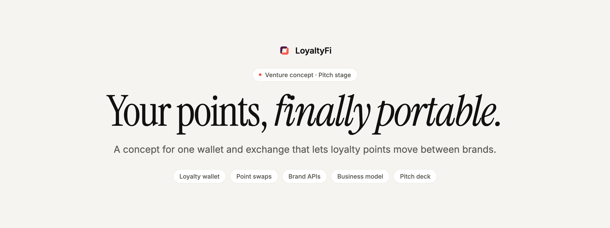
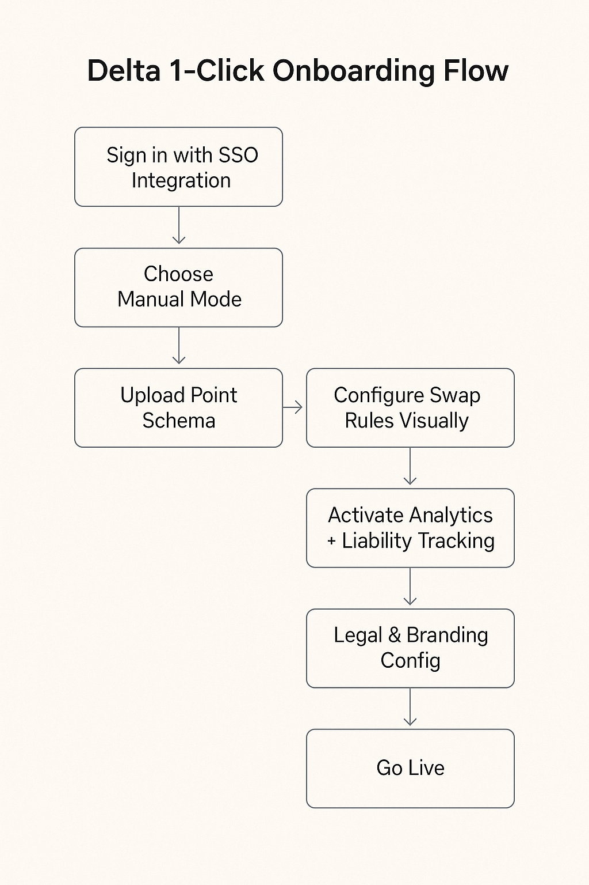

  <picture>
    <source media="(prefers-color-scheme: dark)" srcset=".github/assets/banner-dark.png">
    
  </picture>

  <strong>One wallet for every loyalty point, and a way to swap them.</strong> 
  LoyaltyFi is a venture concept: track airline miles, coffee stars and store points in one place, see what they are worth, and trade them across brands.

  <a href="LoyaltyFi_%20The%20Universal%20Loyalty%20Point%20Exchange.pptx"><strong>Pitch deck</strong></a> ·
  <a href="Business%20Model%20Canvas.docx"><strong>Business model</strong></a> ·
  <a href="#the-idea-in-pictures"><strong>Concept visuals</strong></a> ·
  <a href="#honest-status"><strong>Honest status</strong></a>

  
  
  
  

  
   <strong>Concept mockup,</strong> AI-generated for the pitch. Not a working app. Brand names are illustrative only; there are no partnerships.

## Why LoyaltyFi

Most people belong to a handful of loyalty programs and remember none of the balances. Points sit in separate apps, expire quietly, and can only be spent with the brand that issued them. For brands, every unspent point is a liability on the books.

**LoyaltyFi proposes a shared exchange layer.** Consumers get one wallet that values every balance in dollars and lets them convert, say, hotel points into coffee. Brands plug in through APIs, set their own exchange rules and partners, and gain customers from other programs instead of carrying dead points.

<table>
  <tr>
    <td width="33%" valign="top">
      <h3>👛 See it all</h3>
      Every program in one wallet, with an estimated dollar value and a nudge before points expire.
    </td>
    <td width="33%" valign="top">
      <h3>🔄 Swap it</h3>
      Convert points between participating programs at rates each brand controls, so stranded balances become useful.
    </td>
    <td width="33%" valign="top">
      <h3>🤝 Brands win too</h3>
      New customers from partner programs, a fee on every swap, less unredeemed liability and cross-brand insights.
    </td>
  </tr>
</table>

## The idea in pictures

<table>
  <tr>
    <td width="50%" valign="top">
      
      <h4>The value flywheel</h4>
      How points, customers and fees would move between two brands, a customer and the platform.
    </td>
    <td width="50%" valign="top">
      
      <h4>Brand onboarding</h4>
      The proposed seven-step path for a brand to join: from single sign-on to swap rules to going live.
    </td>
  </tr>
</table>

Both diagrams are pitch illustrations. "Delta" and "Starbucks" appear as example brands only.

## How it would work

| Piece | What the concept describes |
| --- | --- |
| **Consumer wallet** | One app to track all points, show real-time value estimates, send expiry alerts and suggest swaps |
| **Exchange** | Point-to-point conversion between participating programs, with brand-set rates and limits |
| **Brand APIs and SDKs** | Plug-in integration for loyalty systems, point-of-sale and retail apps |
| **Insights dashboards** | Cross-brand analytics for partners, plus optional tools for public-sector reward programs |
| **Token standard** | A proposed common format for loyalty value, so programs can interoperate |

**Business model (proposed):** a small fee on each swap, API and analytics subscriptions for brands, and premium wallet features. Details are in the [business model canvas](Business%20Model%20Canvas.docx).

## How it compares

Wallet and tracking apps already exist; the open question LoyaltyFi explores is a shared, brand-controlled exchange between programs.

| | Single-brand apps | Points trackers | **LoyaltyFi (concept)** |
| --- | :---: | :---: | :---: |
| See balances from many programs | — | ✅ | ✅ |
| Dollar value for every balance | — | Some | ✅ |
| Swap points between unrelated brands | — | — | ✅ Proposed |
| Brands set their own exchange rules | — | — | ✅ Proposed |
| Exists today | ✅ | ✅ | — |

## What's in this repository

| File | What it is |
| --- | --- |
| [Pitch deck](LoyaltyFi_%20The%20Universal%20Loyalty%20Point%20Exchange.pptx) | Problem, solution, market, competitors, business model, roadmap, the ask, and appendices on brands, governments and consumers |
| [Business model canvas](Business%20Model%20Canvas.docx) | Customer segments, value propositions, channels, revenue, resources, partners and costs |
| [Legal disclaimer](LoyaltyFi_Legal_Disclaimer.pdf) | Draft user disclaimer: points are promotional value, not currency or securities |
| [Tax policy explainer](LoyaltyFi_Tax_Policy_Explainer.pdf) | Draft explainer on how point conversions might be taxed |
| `UI Mobile User.png`, `Onboarding.png`, value flywheel | Concept visuals used above |
| [`assets/brand/`](assets/brand/README.md) | Logo and conceptual cover art |

Open the files in any viewer that handles `.pptx`, `.docx`, `.pdf` and `.png`. There is nothing to install or build.

## Honest status

LoyaltyFi is an **early venture concept**, not a product.

- There is **no software** in this repository: no app, exchange, API or token.
- The phone screens are an **AI-generated mockup** and contain placeholder text.
- Brand names (Delta, Starbucks and others) are **examples only**. No brand has agreed to take part.
- Market figures and customer statistics in the deck are **unverified pitch claims**.
- The roadmap in the deck (MVP and pilots in 2025) **has not happened**; treat it as the original plan.
- The legal and tax documents are drafts, **not legal or tax advice**.

## License

No license file is included. This README grants no reuse or redistribution rights; contact the repository owner about permitted use.

   
   
  <strong>LoyaltyFi</strong> · Loyalty shouldn't be locked.

